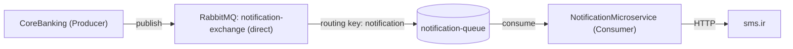

# 🔔 NotificationMicroservice | میکروسرویس اعلان

The consumer service of the CoreBanking project. It reads notification messages from RabbitMQ and sends them as SMS through the sms.ir API.
سرویس مصرف‌کننده (Consumer) پروژه‌ی CoreBanking. این سرویس پیام‌های اعلان را از RabbitMQ می‌خواند و از طریق API سایت sms.ir به صورت پیامک ارسال می‌کند.

---

# 📌 Features | امکانات

✅ Consumes messages from a RabbitMQ queue  
✅ Direct exchange with routing key  
✅ Sends SMS through the sms.ir HTTP API  
✅ Manual message acknowledgement  
✅ Messages stay in the queue while the service is stopped  
✅ Layered structure (Services / Business Logic)  
✅ Secrets stored in a `.env` file

✅ دریافت پیام از صف RabbitMQ  
✅ استفاده از Exchange نوع Direct با Routing Key  
✅ ارسال پیامک با API سایت sms.ir  
✅ تأیید دستی پیام‌ها (Manual Ack)  
✅ ماندن پیام‌ها در صف وقتی سرویس خاموش است  
✅ ساختار لایه‌بندی‌شده (Services / Business Logic)  
✅ نگهداری رمزها و کلیدها در فایل `.env`

---

# 🏗 Architecture | معماری



1. CoreBanking publishes a message (`phone`, `content`) to `notification-exchange`.
2. The direct exchange routes it with the key `notification` to `notification-queue`.
3. This service consumes the message, sends the SMS to sms.ir, and acknowledges the message.

If this service is stopped, messages stay in the queue until it starts again.

۱. CoreBanking یک پیام (`phone` و `content`) به `notification-exchange` می‌فرستد.  
۲. Exchange از نوع Direct پیام را با کلید `notification` به `notification-queue` می‌رساند.  
۳. این سرویس پیام را از صف برمی‌دارد، پیامک را به sms.ir می‌فرستد و پیام را تأیید (Ack) می‌کند.

اگر این سرویس خاموش باشد، پیام‌ها در صف می‌مانند تا سرویس دوباره روشن شود.

---

# 📨 Message Format | قالب پیام

```json
{
  "phone": "09120000000",
  "content": "12345"
}
```

| Field   | Description                 | توضیح                    |
| ------- | --------------------------- | ------------------------ |
| phone   | Receiver mobile number      | شماره‌ی موبایل گیرنده    |
| content | Verification code (OTP)     | کد تأیید (OTP)           |

---

# 🛠 Technologies Used | تکنولوژی‌های استفاده‌شده

- Python
- RabbitMQ (pika)
- sms.ir API (requests)
- python-dotenv
- Layered Architecture
- Microservice Architecture

---

# 📂 Project Structure | ساختار پروژه

```
NotificationMicroservice/
│
├── BusinessLogic/
│   └── notification_business_logic.py
│
├── Common/
│   └── Services/
│       ├── notification_consumer.py
│       └── sms_service.py
│
├── docs/
│   └── images/
│
├── .env.example
├── .gitignore
├── main.py
└── requirements.txt
```

| File                              | Responsibility                       | وظیفه                                  |
| --------------------------------- | ------------------------------------ | -------------------------------------- |
| `main.py`                         | Wires everything and starts consumer | اتصال بخش‌ها و شروع کار Consumer       |
| `notification_consumer.py`        | RabbitMQ connection and consuming    | اتصال به RabbitMQ و دریافت پیام‌ها     |
| `notification_business_logic.py`  | Handles each received message        | پردازش هر پیام دریافتی                 |
| `sms_service.py`                  | HTTP calls to sms.ir                 | ارسال درخواست HTTP به sms.ir           |

---

# ⚙️ Environment Variables | متغیرهای محیطی

Copy `.env.example` to `.env` and fill in the values. The `.env` file is ignored by Git and must never be uploaded.
فایل `.env.example` را به `.env` کپی کنید و مقدارها را پر کنید. فایل `.env` توسط Git نادیده گرفته می‌شود و هرگز نباید آپلود شود.

| Variable                | Description                | توضیح                          |
| ----------------------- | -------------------------- | ------------------------------ |
| `RABBITMQ_HOST`         | RabbitMQ server address    | آدرس سرور RabbitMQ             |
| `RABBITMQ_PORT`         | RabbitMQ port (5672)       | پورت RabbitMQ (معمولاً 5672)   |
| `RABBITMQ_USERNAME`     | RabbitMQ username          | نام کاربری RabbitMQ            |
| `RABBITMQ_PASSWORD`     | RabbitMQ password          | رمز عبور RabbitMQ              |
| `RABBITMQ_VIRTUAL_HOST` | RabbitMQ virtual host      | Virtual Host در RabbitMQ       |
| `SMSIR_API_KEY`         | sms.ir API key             | کلید API سایت sms.ir           |
| `SMSIR_LINE_NUMBER`     | sms.ir line number         | شماره‌ی خط sms.ir              |

---

# 🚀 How To Run | نحوه اجرا

Make sure RabbitMQ is installed and running, then clone the repository:
مطمئن شوید RabbitMQ نصب و روشن است، سپس پروژه را کلون کنید:

```
git clone https://github.com/zahrasalimzadeh/NotificationMicroservice.git
```

Open the project folder:

```
cd NotificationMicroservice
```

Install the requirements:

```
pip install -r requirements.txt
```

Create your `.env` file from the example and fill in the values:

```
copy .env.example .env
```

Run the service:

```
python main.py
```

The service keeps running and waits for new messages. Start CoreBanking and log in to send a message.
سرویس همیشه روشن می‌ماند و منتظر پیام جدید است. برای ارسال پیام، CoreBanking را اجرا کنید و لاگین کنید.

---

# 🎥 Demo | دمو

### Architecture Diagram | نمودار معماری


### RabbitMQ Dashboard | داشبورد RabbitMQ

Message waiting in the queue (consumer stopped):
پیام در صف منتظر است (Consumer خاموش):


Queue is empty after the consumer processed the message:
صف بعد از پردازش پیام توسط Consumer خالی می‌شود:


### Consumer Output | خروجی Consumer


---

# 👩‍💻 Developer | توسعه‌دهنده

**Zahra Salimzadeh**

- LinkedIn: <https://www.linkedin.com/in/zahra-salimzadeh-5767582ab/>
- Email: <zahrasalimzadeh7@gmail.com>
