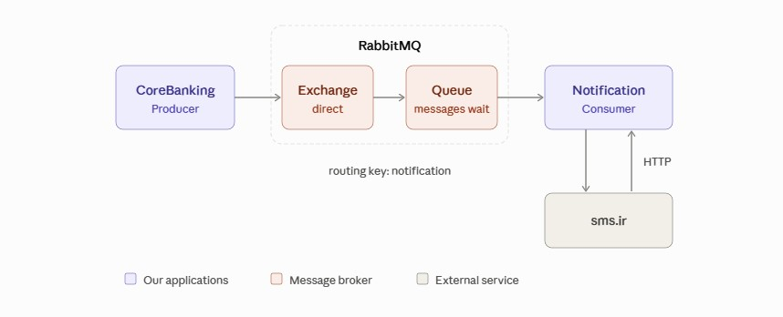
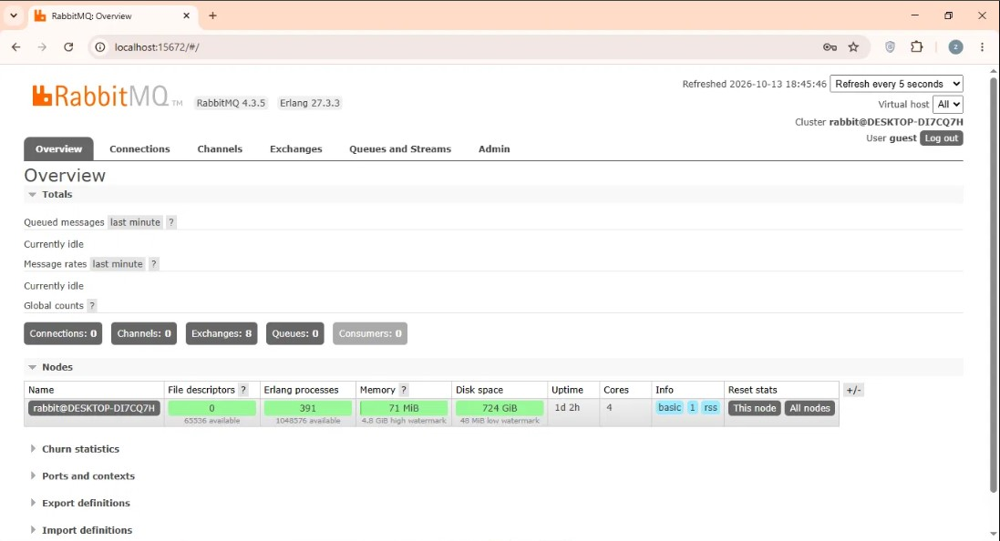
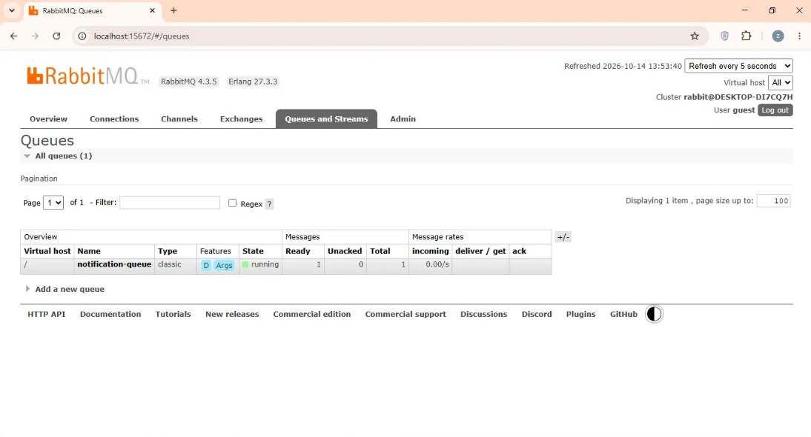
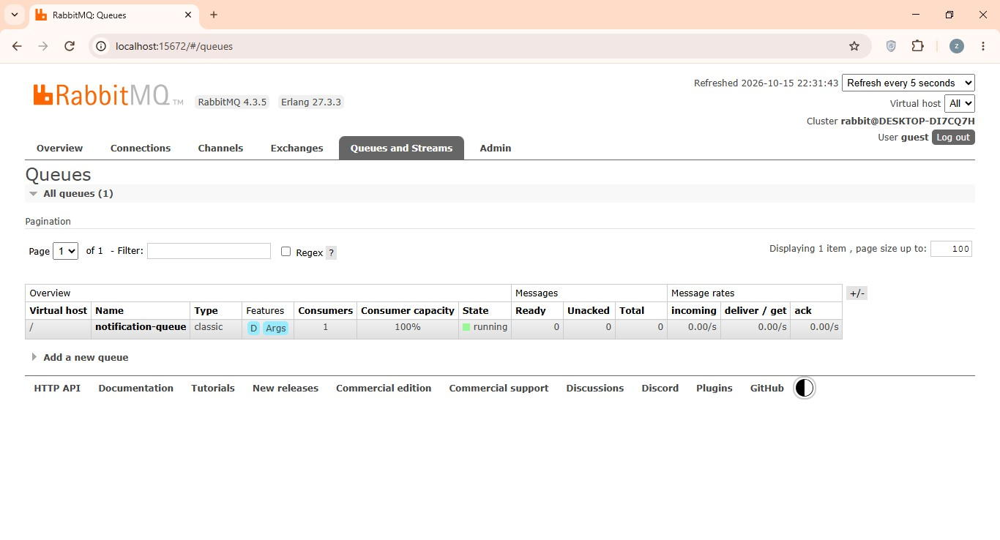

# 🔔 NotificationMicroservice | میکروسرویس اعلان

The consumer service of the CoreBanking project. It reads notification messages from RabbitMQ and sends them as SMS through the sms.ir API.

<div dir="rtl">

سرویس مصرف‌کننده (Consumer) پروژه‌ی CoreBanking. این سرویس پیام‌های اعلان را از RabbitMQ می‌خواند و از طریق API سایت sms.ir به صورت پیامک ارسال می‌کند.

</div>

---

# 📌 Features | امکانات

- ✅ Consumes messages from a RabbitMQ queue
- ✅ Direct exchange with routing key
- ✅ Sends SMS through the sms.ir HTTP API
- ✅ Manual message acknowledgement
- ✅ Messages stay in the queue while the service is stopped
- ✅ Layered structure (Services / Business Logic)
- ✅ Secrets stored in a `.env` file

<div dir="rtl">

- ✅ دریافت پیام از صف RabbitMQ
- ✅ استفاده از Exchange نوع Direct با Routing Key
- ✅ ارسال پیامک با API سایت sms.ir
- ✅ تأیید دستی پیام‌ها (Manual Ack)
- ✅ ماندن پیام‌ها در صف وقتی سرویس خاموش است
- ✅ ساختار لایه‌بندی‌شده (Services / Business Logic)
- ✅ نگهداری رمزها و کلیدها در فایل `.env`

</div>

---

# 🏗 Architecture | معماری



[Open the interactive diagram | باز کردن نمودار تعاملی](https://zahrasalimzadeh.github.io/NotificationMicroservice/diagram.html)

1. CoreBanking publishes a message (`phone`, `content`) to `notification-exchange`.
2. The direct exchange routes it with the key `notification` to `notification-queue`.
3. This service consumes the message, sends the SMS to sms.ir, and acknowledges the message.

If this service is stopped, messages stay in the queue until it starts again.

<div dir="rtl">

1. CoreBanking یک پیام (`phone` و `content`) به `notification-exchange` می‌فرستد.
2. Exchange از نوع Direct پیام را با کلید `notification` به `notification-queue` می‌رساند.
3. این سرویس پیام را از صف برمی‌دارد، پیامک را به sms.ir می‌فرستد و پیام را تأیید (Ack) می‌کند.

اگر این سرویس خاموش باشد، پیام‌ها در صف می‌مانند تا سرویس دوباره روشن شود.

</div>

---

# 📨 Message Format | قالب پیام

```json
{
  "phone": "09120000000",
  "content": "12345"
}
```

| Field   | Description                 | توضیح                    |
| ------- | --------------------------- | ------------------------ |
| phone   | Receiver mobile number      | شماره‌ی موبایل گیرنده    |
| content | Verification code (OTP)     | کد تأیید (OTP)           |

---

# 🛠 Technologies Used | تکنولوژی‌های استفاده‌شده

- Python
- RabbitMQ (pika)
- sms.ir API (requests)
- python-dotenv
- Layered Architecture
- Microservice Architecture

---

# 📂 Project Structure | ساختار پروژه

```
NotificationMicroservice/
│
├── BusinessLogic/
│   └── notification_business_logic.py
│
├── Common/
│   └── Services/
│       ├── notification_consumer.py
│       └── sms_service.py
│
├── docs/
│   └── diagram.html
│
├── .env.example
├── .gitignore
├── diagram.jpg
├── main.py
├── rabbitmq-idle.png
├── queue-ready.png
├── queue-empty.png.jpg
└── requirements.txt
```

| File                              | Responsibility                       | وظیفه                                  |
| --------------------------------- | ------------------------------------ | -------------------------------------- |
| `main.py`                         | Wires everything and starts consumer | اتصال بخش‌ها و شروع کار Consumer       |
| `notification_consumer.py`        | RabbitMQ connection and consuming    | اتصال به RabbitMQ و دریافت پیام‌ها     |
| `notification_business_logic.py`  | Handles each received message        | پردازش هر پیام دریافتی                 |
| `sms_service.py`                  | HTTP calls to sms.ir                 | ارسال درخواست HTTP به sms.ir           |

---

# ⚙️ Environment Variables | متغیرهای محیطی

Copy `.env.example` to `.env` and fill in the values. The `.env` file is ignored by Git and must never be uploaded.

<div dir="rtl">

فایل `.env.example` را به `.env` کپی کنید و مقدارها را پر کنید. فایل `.env` توسط Git نادیده گرفته می‌شود و هرگز نباید آپلود شود.

</div>

| Variable                | Description                | توضیح                          |
| ----------------------- | -------------------------- | ------------------------------ |
| `RABBITMQ_HOST`         | RabbitMQ server address    | آدرس سرور RabbitMQ             |
| `RABBITMQ_PORT`         | RabbitMQ port (5672)       | پورت RabbitMQ (معمولاً 5672)   |
| `RABBITMQ_USERNAME`     | RabbitMQ username          | نام کاربری RabbitMQ            |
| `RABBITMQ_PASSWORD`     | RabbitMQ password          | رمز عبور RabbitMQ              |
| `RABBITMQ_VIRTUAL_HOST` | RabbitMQ virtual host      | Virtual Host در RabbitMQ       |
| `SMSIR_API_KEY`         | sms.ir API key             | کلید API سایت sms.ir           |
| `SMSIR_LINE_NUMBER`     | sms.ir line number         | شماره‌ی خط sms.ir              |

---

# 🚀 How To Run | نحوه اجرا

Make sure RabbitMQ is installed and running.

<div dir="rtl">

مطمئن شوید RabbitMQ نصب و روشن است.

</div>

**1. Clone the repository | کلون کردن پروژه**

```
git clone https://github.com/zahrasalimzadeh/NotificationMicroservice.git
```

**2. Open the project folder | باز کردن پوشه‌ی پروژه**

```
cd NotificationMicroservice
```

**3. Install the requirements | نصب پیش‌نیازها**

```
pip install -r requirements.txt
```

**4. Create your `.env` file and fill in the values | ساخت فایل `.env` و پر کردن مقدارها**

```
copy .env.example .env
```

**5. Run the service | اجرای سرویس**

```
python main.py
```

The service keeps running and waits for new messages. Start CoreBanking and log in to send a message.

<div dir="rtl">

سرویس همیشه روشن می‌ماند و منتظر پیام جدید است. برای ارسال پیام، CoreBanking را اجرا کنید و لاگین کنید.

</div>

---

# 🎥 Demo | دمو

### RabbitMQ Dashboard | داشبورد RabbitMQ

**1. RabbitMQ is running and no queue exists yet. The queue is created automatically when the application starts.**

<div dir="rtl">

RabbitMQ روشن است و هنوز صفی وجود ندارد. صف به صورت خودکار هنگام اجرای برنامه ساخته می‌شود.

</div>



**2. A message is waiting in `notification-queue` (consumer stopped).**

<div dir="rtl">

یک پیام در `notification-queue` منتظر است (Consumer خاموش).

</div>



**3. The consumer is connected (Consumers: 1) and the queue is empty after the message was processed.**

<div dir="rtl">

Consumer به صف وصل است (Consumers: 1) و صف بعد از پردازش پیام خالی است.

</div>



---

# 📝 Notes | نکات

- An sms.ir account with enough credit is required to actually deliver SMS. Without credit, sms.ir responds with status `102` (insufficient credit), while the RabbitMQ flow still works.
- The queue and exchange names must be the same in CoreBanking and in this service.

<div dir="rtl">

- برای ارسال واقعی پیامک، حساب sms.ir باید اعتبار کافی داشته باشد. بدون اعتبار، sms.ir کد `102` (اعتبار کافی نیست) برمی‌گرداند، ولی مسیر RabbitMQ همچنان درست کار می‌کند.
- نام Exchange و Queue باید در CoreBanking و در این سرویس یکسان باشد.

</div>

---

# 👩‍💻 Developer | توسعه‌دهنده

**Zahra Salimzadeh**

- LinkedIn: <https://www.linkedin.com/in/zahra-salimzadeh-5767582ab/>
- Email: <zahrasalimzadeh7@gmail.com>
